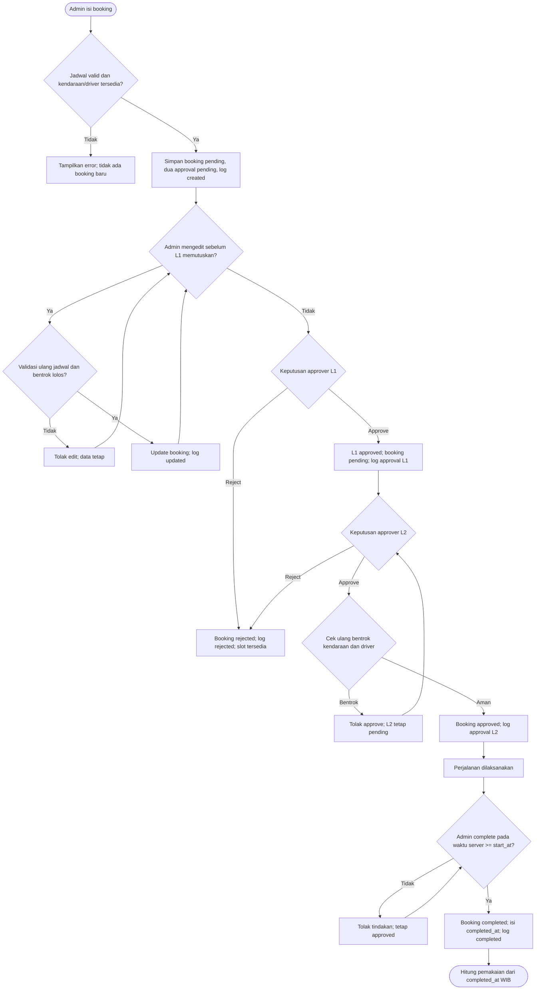
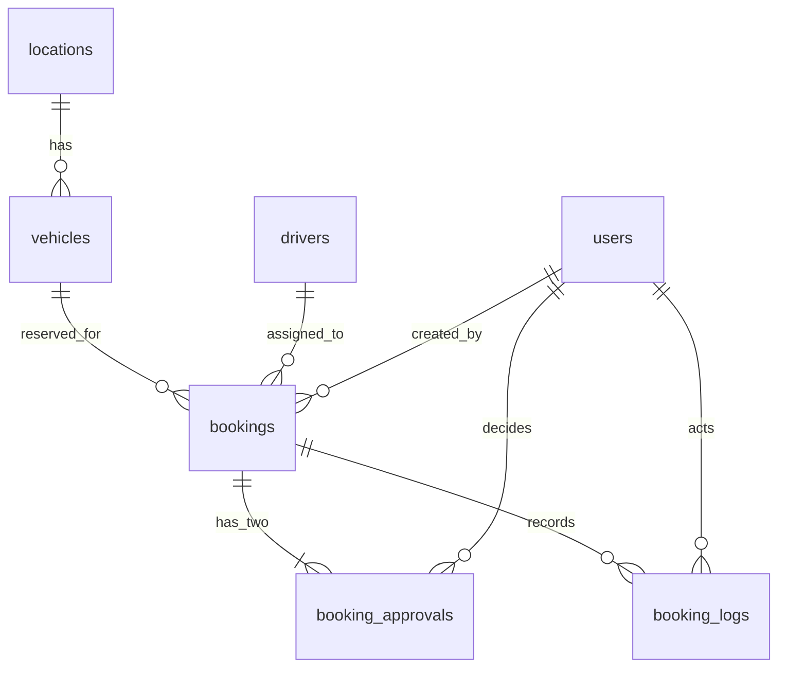

# FleetOps: spesifikasi teknis versi pertama

Status: baseline desain disetujui pengguna; implementasi v1 mengikuti rencana `docs/superpowers/plans/2026-10-15-fleetops-v1.md` dan telah diverifikasi. Target pengumpulan technical test: 16 Oktober 2026 pukul 12.00. Versi runtime yang diuji dan langkah menjalankan aplikasi tercatat di README.

## 1. Tujuan dan batas produk

Admin pool memesan kendaraan atas nama pegawai, memilih kendaraan, driver, serta dua orang penyetuju. Penyetuju mengambil keputusan berurutan. Admin mengonfirmasi perjalanan yang benar-benar selesai; dashboard menghitung pemakaian aktual dan laporan menampilkan pemesanan menurut tanggal pembuatannya.

**Keputusan utama: `approved` tidak sama dengan `used`.** Booking baru dihitung sebagai pemakaian ketika statusnya `completed`. Tidak ada status `ongoing` pada versi ini.

### Wajib pada versi pertama

- Login berbasis session Laravel dan CSRF; dua peran: `admin` dan `approver`.
- Admin membuat booking untuk pegawai yang tidak memiliki akun, memilih kendaraan, driver, approver level 1 dan level 2 yang berbeda, serta boleh mengedit selama level 1 belum memutuskan.
- Persetujuan tepat dua level, berurutan, dengan opsi menolak pada setiap level.
- Kendaraan dan driver tidak boleh dipakai oleh dua booking aktif dengan rentang jadwal yang bertabrakan.
- Admin menandai booking yang sudah disetujui sebagai selesai; waktu selesai ditentukan server.
- Enam event log proses, dashboard pemakaian aktual, laporan periodik, dan ekspor `.xlsx`.
- UI Vue 3 yang responsif, memakai bagian relevan dari Hope UI; PostgreSQL dengan constraint/index yang disepakati; feature tests; PDM; activity diagram; README untuk menjalankan dan mendemokan aplikasi.
- Data demo: satu kantor pusat, satu cabang, enam lokasi tambang, kendaraan milik perusahaan dan sewa, driver, admin, serta minimal dua akun approver.

### Di luar kriteria penerimaan versi pertama

CRUD kendaraan, driver, lokasi, dan pengguna; halaman approval atau log terpisah; monitoring BBM; jadwal servis; GPS; notifikasi; vendor rental; konfigurasi jumlah level approval; analitik tambahan. CRUD master data hanya dapat dipertimbangkan setelah semua kebutuhan inti berjalan dan lulus uji. Jangan menampilkan menu untuk fitur yang belum dibangun.

## 2. Arsitektur dan tanggung jawab

Satu aplikasi Laravel 12 berisi Vue 3, Vite, komponen/layout Hope UI yang diperlukan, serta PostgreSQL. Laravel melayani halaman awal dan route JSON pada origin yang sama. Route `/api/*` didefinisikan dalam `routes/web.php`, sehingga memakai session, cookie, dan CSRF bawaan. `routes/api.php` tidak diperlukan untuk API stateless yang tidak dibangun di versi ini. Frontend tidak menyimpan token autentikasi.

Distribusi demo menggunakan Docker Compose: satu service aplikasi Laravel dengan aset Vue yang dibangun melalui Vite pada tahap build image, dan satu service PostgreSQL dengan penyimpanan persisten. Aplikasi memakai session dan cache berbasis file serta queue sinkron, tanpa Redis. Migration dan seeding dijalankan eksplisit setelah database siap, bukan setiap container dimulai. Tes memakai database PostgreSQL terpisah supaya data demo tidak terhapus. Perintah Docker dan versi image/runtime yang benar-benar dipakai dicatat di README setelah dijalankan.

Laravel menangani autentikasi, otorisasi, aturan status, pemeriksaan konflik, pembuatan kode booking, log, statistik, dan laporan. Vue menampilkan enam jenis halaman, mengirim input, dan menampilkan respons server. Semua mutasi penting disimpan secara atomik bersama lognya dengan transaksi database. Pemeriksaan bentrok di tingkat aplikasi tidak menjamin bebas bentrok jika dua admin menyimpan booking persis bersamaan; keterbatasan ini diterima untuk technical test. Peningkatan kendali konkurensi baru dipertimbangkan bila kebutuhan nyata muncul.

Template Hope UI yang dipilih: [hope-ui-vue-dashboard](https://github.com/iqonicdesignofficial/hope-ui-vue-dashboard). Repositorinya berbasis Vue CLI; integrasi dengan Vite berarti memindahkan hanya layout, gaya, dan komponen yang dipakai, bukan seluruh aplikasi demo, halaman contoh, serta dependensinya. Cantumkan atribusi sumber saat mengadopsi aset dan periksa ketentuan lisensi/aset yang benar-benar digunakan pada implementasi.

## 3. Aturan bisnis

| ID | Aturan |
|---|---|
| BR-01 | Satu kendaraan tidak boleh berada pada dua booking aktif dengan jadwal bertabrakan. |
| BR-02 | Satu driver tidak boleh berada pada dua booking aktif dengan jadwal bertabrakan. |
| BR-03 | Booking `rejected` tidak menahan kendaraan atau driver. Status aktif untuk cek konflik adalah `pending`, `approved`, dan `completed`. |
| BR-04 | Booking yang berurutan diperbolehkan jika `existing.end_at = new.start_at`. Bentrok terjadi ketika `new_start < existing_end AND new_end > existing_start`. |
| BR-05 | Setiap booking memiliki tepat dua approval, level 1 dan level 2. |
| BR-06 | Dua level approval harus ditugaskan kepada akun approver yang berbeda. |
| BR-07 | Level 2 hanya dapat mengambil keputusan setelah level 1 `approved`. |
| BR-08 | Booking menjadi `approved` hanya setelah kedua level `approved`. |
| BR-09 | Penolakan pada salah satu level menjadikan booking `rejected`. Approval berikutnya tetap `pending` tetapi tidak lagi actionable. |
| BR-10 | Hanya admin yang dapat mengubah booking `approved` menjadi `completed`. |
| BR-11 | Booking `completed` wajib memiliki `completed_at`; status lain wajib memiliki `completed_at = NULL`. |
| BR-12 | Grafik pemakaian menghitung booking `completed` menurut bulan `completed_at` dalam Asia/Jakarta. |
| BR-13 | Periode laporan dan daftar pemesanan memakai `bookings.created_at` dalam Asia/Jakarta. |
| BR-14 | Admin hanya boleh mengedit booking selama approval level 1 masih `pending`. |
| BR-15 | Edit mengulang validasi `end_at > start_at` dan pemeriksaan bentrok kendaraan serta driver, tanpa membandingkan booking dengan dirinya sendiri. |
| BR-16 | Edit yang berhasil menambahkan `BOOKING_UPDATED` ke log. |
| BR-17 | Setelah keputusan pertama level 1, booking tidak dapat diedit. Kedua approval tidak perlu di-reset selama edit yang sah. |
| BR-18 | Booking `approved` hanya dapat ditandai selesai jika waktu server sudah mencapai `start_at`. |
| BR-19 | Penyelesaian sebelum `end_at` diperbolehkan, tetapi slot reservasi kendaraan dan driver tetap mengikuti `end_at`, bukan `completed_at`. |
| BR-20 | Seluruh waktu bisnis pada UI, dashboard, dan laporan menggunakan Asia/Jakarta; timestamp database tetap `timestamptz`. |
| BR-21 | Periode tanggal memakai batas awal inklusif dan batas akhir eksklusif berdasarkan Asia/Jakarta. |

Pemeriksaan konflik berlaku saat create, saat edit, dan sebelum keputusan approve level 2. Jika pemeriksaan terakhir menemukan konflik, keputusan approve tidak dicatat: booking tetap `pending`, level 1 `approved`, level 2 `pending`. Approver level 2 masih dapat menolak booking tersebut. Jika booking yang berbenturan kemudian ditolak, pemeriksaan ulang dapat lolos. Tidak ada edit setelah level 1 memutuskan.

## 4. State transition dan log

`bookings.status` hanya `pending`, `approved`, `rejected`, atau `completed`. Selama booking masih `pending`, label UI "Pending Level 1" dan "Pending Level 2" diturunkan dari dua baris approval. Pada booking `rejected`, level berikutnya yang belum memutuskan ditampilkan sebagai tidak dilanjutkan, bukan tugas yang dapat diproses.

| Sebelum | Aksi | Sesudah | Event log |
|---|---|---|---|
| Tidak ada booking | Admin membuat booking valid | Booking `pending`; L1 dan L2 `pending` | `BOOKING_CREATED` |
| Booking `pending`, L1 `pending` | Admin mengedit booking valid | State approval tetap | `BOOKING_UPDATED` |
| Booking `pending`, L1 `pending` | L1 approve | L1 `approved`; booking tetap `pending` | `APPROVAL_LEVEL_1_APPROVED` |
| Booking `pending`, L1 `pending` | L1 reject | L1 `rejected`; booking `rejected` | `BOOKING_REJECTED` |
| Booking `pending`, L1 `approved`, L2 `pending` | L2 approve; cek konflik lolos | L2 `approved`; booking `approved` | `APPROVAL_LEVEL_2_APPROVED` |
| Booking `pending`, L1 `approved`, L2 `pending` | L2 reject | L2 `rejected`; booking `rejected` | `BOOKING_REJECTED` |
| Booking `approved`, waktu server `>= start_at` | Admin complete | Booking `completed`; `completed_at` diisi server | `BOOKING_COMPLETED` |

Keputusan L2 dikirim sebagai `approve` atau `reject`; Laravel mencari approval milik pengguna yang sedang login dan memeriksa gilirannya. Permintaan yang gagal tidak mengubah booking, approval, atau log keberhasilan. Level penolakan dapat ditemukan dari approval milik `actor_id` pada booking yang sama; tidak perlu jenis event reject tambahan.

Saat membuat booking, admin mengisi pegawai pemakai, tujuan, keperluan, kendaraan, driver, kedua waktu, serta dua approver. Laravel menghasilkan `code` unik setelah memperoleh ID booking, misalnya `BK-20261020-001` untuk ID 1 pada tanggal pembuatan WIB. Selama edit diizinkan, admin boleh mengubah field tersebut kecuali `code` dan pembuatnya; perubahan approver memperbarui penugasan pada dua baris approval yang masih `pending`. Seluruh perubahan dan log disimpan dalam satu transaksi.

### Activity diagram pemesanan

## 5. Physical data model

Tujuh tabel berikut adalah tabel domain aplikasi. Tabel internal Laravel, jika ada karena konfigurasi framework, tidak mengubah model bisnis ini. Semua PK adalah `bigint` auto-increment; semua FK `bigint` wajib. `created_at` dan `updated_at` memakai `timestamptz` kecuali log yang hanya memiliki `created_at`. Tidak ada fitur hapus historis pada UI; FK memakai `ON DELETE RESTRICT` agar booking, approval, dan log tidak kehilangan referensi.

| Tabel | Kolom (tipe PostgreSQL) | Constraint dan indeks |
|---|---|---|
| `users` | `id bigint PK`, `name varchar(120) NOT NULL`, `email varchar(255) NOT NULL`, `password varchar(255) NOT NULL`, `role varchar(20) NOT NULL`, `created_at timestamptz NOT NULL`, `updated_at timestamptz NOT NULL` | `UNIQUE(email)`; `CHECK(role IN ('admin','approver'))` |
| `locations` | `id bigint PK`, `name varchar(120) NOT NULL`, `region varchar(120) NOT NULL`, `type varchar(20) NOT NULL`, timestamps | `CHECK(type IN ('head_office','branch','mine'))` |
| `vehicles` | `id bigint PK`, `plate_number varchar(30) NOT NULL`, `type varchar(20) NOT NULL`, `ownership varchar(20) NOT NULL`, `location_id bigint NOT NULL` FK, timestamps | `UNIQUE(plate_number)`; `CHECK(type IN ('passenger','goods'))`; `CHECK(ownership IN ('company','rental'))`; FK ke `locations.id` |
| `drivers` | `id bigint PK`, `name varchar(120) NOT NULL`, `phone varchar(30) NULL`, timestamps | Tidak perlu data lisensi/SIM untuk alur ini |
| `bookings` | `id bigint PK`, `code varchar(30) NOT NULL`, `created_by bigint NOT NULL` FK, `vehicle_id bigint NOT NULL` FK, `driver_id bigint NOT NULL` FK, `requester_name varchar(120) NOT NULL`, `destination varchar(255) NOT NULL`, `purpose text NOT NULL`, `start_at timestamptz NOT NULL`, `end_at timestamptz NOT NULL`, `status varchar(20) NOT NULL DEFAULT 'pending'`, `completed_at timestamptz NULL`, timestamps | `UNIQUE(code)`; FK ke `users`, `vehicles`, `drivers`; `CHECK(end_at > start_at)`; `CHECK(status IN ('pending','approved','rejected','completed'))`; `CHECK((status = 'completed' AND completed_at IS NOT NULL) OR (status <> 'completed' AND completed_at IS NULL))` |
| `booking_approvals` | `id bigint PK`, `booking_id bigint NOT NULL` FK, `approver_id bigint NOT NULL` FK, `level smallint NOT NULL`, `status varchar(20) NOT NULL DEFAULT 'pending'`, `decided_at timestamptz NULL`, timestamps | FK ke `bookings`, `users`; `UNIQUE(booking_id,level)`; `UNIQUE(booking_id,approver_id)`; `CHECK(level IN (1,2))`; `CHECK(status IN ('pending','approved','rejected'))`; `CHECK((status = 'pending' AND decided_at IS NULL) OR (status IN ('approved','rejected') AND decided_at IS NOT NULL))` |
| `booking_logs` | `id bigint PK`, `booking_id bigint NOT NULL` FK, `actor_id bigint NOT NULL` FK, `action varchar(40) NOT NULL`, `created_at timestamptz NOT NULL` | FK ke `bookings`, `users`; append-only; `CHECK(action IN ('BOOKING_CREATED','BOOKING_UPDATED','APPROVAL_LEVEL_1_APPROVED','APPROVAL_LEVEL_2_APPROVED','BOOKING_REJECTED','BOOKING_COMPLETED'))` |

Indeks tambahan: `bookings(vehicle_id,start_at,end_at)`, `bookings(driver_id,start_at,end_at)`, `bookings(status)`, `bookings(created_at)`, `bookings(completed_at)`, dan `booking_approvals(approver_id,status)`. Constraint lintas baris "tepat dua approval" dan urutan keputusan dijaga oleh aturan aplikasi serta transaksi pembuatan, bukan trigger. Laravel hanya memilih akun dengan `role = approver` untuk kedua level.

## 6. Kontrak waktu dan periode

- `<input type="datetime-local">` mengirim string tanpa offset seperti `2026-10-20T08:00`. Vue tidak memakai `new Date(value).toISOString()` untuk input ini. Laravel mem-parsing nilai tersebut secara eksplisit dalam `Asia/Jakarta`, lalu menyimpan instannya dalam kolom `timestamptz`.
- Respons API memberi waktu lengkap dengan offset, misalnya `2026-10-20T08:00:00+07:00`. UI menampilkan waktu dalam WIB walaupun browser berada di zona lain.
- `completed_at` berasal dari jam server, tidak diterima dari payload Vue. Boleh lebih awal dari `end_at`, tetapi tidak lebih awal dari `start_at`. Slot konflik tetap `[start_at, end_at)`.
- Laporan `from=2026-10-01&to=2026-10-31` berarti `created_at >= 2026-10-01 00:00 WIB AND created_at < 2026-11-01 00:00 WIB`; batas dapat dikonversi ke instan UTC saat query. Jika kedua tanggal diisi, `from` tidak boleh setelah `to`.
- Grafik mengelompokkan `completed_at` menurut bulan setelah konversi ke `Asia/Jakarta`, untuk tahun berjalan WIB. Contoh `2026-11-01 00:15 WIB` dihitung November meskipun waktu UTC-nya masih Oktober. KPI dashboard menghitung total sepanjang data yang tersedia, bukan hanya tahun grafik.

## 7. Kontrak HTTP minimum

Semua route didefinisikan di `routes/web.php`. Login memakai kredensial email/password dan session Laravel, lalu regenerasi session. Respons login memberikan token CSRF dari session baru agar Vue memperbarui header Axios sebelum mutasi pertama. Logout menghapus autentikasi, menginvalidasi session, dan memberikan token CSRF baru. JSON request menyertakan `Accept: application/json`, session cookie, dan token CSRF untuk mutasi. Admin diarahkan ke `/dashboard`; approver ke `/bookings`.

| Metode dan path | Akses | Kegunaan |
|---|---|---|
| `POST /login` | Guest | Login session |
| `POST /logout` | Login | Logout session |
| `GET /api/me` | Login | Identitas dan role pengguna |
| `GET /api/booking-options` | Admin | Kendaraan, driver, dan akun approver untuk form |
| `GET /api/booking-filter-options` | Login | Daftar id dan label kendaraan, driver, serta approver untuk filter |
| `GET /api/bookings` | Login | Daftar; admin melihat semua, approver hanya yang ditujukan kepadanya; filter `search`, `status`, `from`, `to`, `vehicle_id`, `driver_id`, `approver_id` |
| `GET /api/bookings/{booking}` | Admin/approver terkait | Detail, dua approval, log |
| `POST /api/bookings` | Admin | Buat booking, dua approval, dan log |
| `PATCH /api/bookings/{booking}` | Admin | Edit selama L1 `pending`, cek ulang konflik, log update |
| `POST /api/bookings/{booking}/decision` | Approver terkait | Body `{ "decision": "approve" }` atau `{ "decision": "reject" }`; level diambil dari akun login |
| `POST /api/bookings/{booking}/complete` | Admin | Tandai selesai jika `approved` dan waktu server `>= start_at` |
| `GET /api/dashboard` | Admin | Total bookings, pending, approved, completed trips, grafik bulanan `completed_at` WIB |
| `GET /api/reports/bookings/export` | Admin | File `.xlsx` dari semua filter daftar booking yang sama |

`201` untuk create; `200` untuk update/decision/complete dan data; `401` untuk JSON tanpa login; `403` jika tidak berhak; `419` untuk CSRF gagal; `422` untuk bentuk/input invalid dengan `errors` per kolom; `409` untuk jadwal bentrok atau state bisnis yang tidak memungkinkan. Respons berhasil dapat berisi `{ "message": "...", "data": {...} }` tanpa envelope tambahan. Ekspor merespons file `.xlsx`, bukan JSON. `decision`, `approver_id`, dan `level` dari payload tidak boleh dipakai sebagai sumber otorisasi; hanya `decision` yang diterima pada endpoint keputusan.

Filter teks mencari kode, nama pemakai, atau tujuan tanpa membedakan kapital; `%` dan `_` dicari sebagai karakter literal. Filter kendaraan, driver, dan approver dipadukan dengan status dan rentang tanggal sebagai kondisi AND. Approver tetap dibatasi pada booking yang ditugaskan kepadanya, sekalipun parameter `approver_id` menunjuk pengguna lain. Daftar dan laporan menyimpan filter aktif di query URL. Periode `from`/`to` tetap merujuk `created_at` WIB dengan awal inklusif dan akhir eksklusif.

Ekspor memakai ketujuh filter yang sama dengan daftar admin. Kolomnya: kode booking, pegawai pemakai, kendaraan, driver, tujuan, jadwal, tanggal pembuatan WIB, approver level 1 dan 2 beserta keputusannya, serta status booking. Route UI Vue selain `/api/*` harus tetap membuka halaman awal saat browser di-refresh langsung pada URL detail atau laporan.

## 8. UI dan navigasi

| Route Vue | Peran | Isi |
|---|---|---|
| `/login` | Guest | Form login dan pesan kesalahan |
| `/dashboard` | Admin | Empat KPI: total bookings, pending, approved, completed trips; satu grafik pemakaian bulanan dengan keterangan "completed trips (WIB)" |
| `/bookings` | Admin, approver | Filter kata kunci, status, tanggal dibuat WIB, kendaraan, driver, penyetuju, lalu daftar kode, pemakai, jadwal, approval, status, dan aksi. Approver hanya melihat booking yang menunjuk dirinya |
| `/bookings?detail={id}` | Admin, approver terkait | Dialog detail, approval, riwayat, dan aksi yang sesuai peran; query filter lain tetap disimpan |
| `/bookings/create`, `/bookings/:id/edit` | Admin | Satu jenis form buat/edit; edit hanya saat L1 `pending`; input jadwal dilabeli WIB |
| `/bookings/:id` | Admin, approver terkait | Deep link lama yang dialihkan ke `/bookings?detail={id}` |
| `/reports` | Admin | Filter bersama dengan daftar, tabel hasil, dialog detail, ekspor yang memakai filter aktif, dan keterangan periode tanggal pembuatan WIB |

Sidebar admin: Dashboard, Bookings, Reports, Logout. Sidebar approver: Bookings, Logout. Detail menampung riwayat approval dan log tanpa halaman tambahan; Edit tetap membuka form penuh. Query URL mempertahankan dialog saat refresh; Back menutup dialog dan mengembalikan daftar dengan filter sebelumnya. Dialog detail dan alert memakai `<dialog>` native, fokus awal terlihat, Escape membatalkan konfirmasi, dan konfirmasi tidak mengirim request jika dibatalkan. Alert berdiri di atas backdrop solid dengan bayangan ringan agar terpisah dari halaman; dialog detail membatasi tinggi dan menggulir isinya agar judul serta tombol tutup tetap mudah dicapai. Feedback request menggunakan alert dialog global; state loading, empty, retry, dan validasi per-field tetap tampil dekat konten terkait. Border input diperkuat pada tema terang dan gelap agar batas kontrol tetap terlihat. Tabel dan dialog dapat dipakai dengan keyboard dan di layar sempit. Vue dapat menyembunyikan complete sebelum `start_at`, tetapi Laravel tetap memutuskan dengan jam server.

## 9. Data demo, pengujian, dan serah terima

Seeder menyediakan delapan lokasi, kendaraan `passenger`/`goods` dan `company`/`rental`, driver, satu admin, serta minimal dua approver. Sediakan booking dalam beberapa tahap dan setidaknya satu booking `completed` pada bulan berjalan WIB supaya grafik demo menunjukkan hasil dari data sungguhan. Kredensial demo baru dicatat dalam README setelah akun seeder dan passwordnya benar-benar dibuat.

Feature tests Laravel memeriksa: login/CSRF termasuk token baru setelah login; hak akses; create atomik dengan dua approval; bentrok kendaraan dan driver; filter tujuh parameter dan ekspor dengan hasil sama; approval berurutan, reject, konflik L2, completion, log, dashboard dan batas periode WIB. Tes `node:test` memeriksa query filter dan antrian dialog. Uji browser mencakup filter URL, refresh/Back, retry, detail modal dari daftar/laporan, konfirmasi Escape, validasi form, kegagalan unduh, alur L1/L2/reject/complete, tema, fokus, dan mobile.

README akhir memuat deskripsi proyek, stack, versi PHP/PostgreSQL/Node/framework yang **terverifikasi dari lingkungan implementasi**, prasyarat Docker Compose, penyiapan `.env` lokal tanpa kredensial rahasia di repo, perintah build/jalankan, migration/seeding, perintah tes pada database terpisah, akun demo, serta langkah menggunakan fitur. Dokumen ini menyatakan BBM dan servis sebagai pengembangan berikutnya, bukan fitur yang sudah ada.
